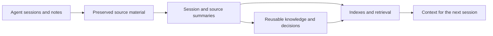

# SecondBrain

**A template and engine for your own AI-assisted second brain.**

Clone the template, connect your AI agent, and start adding notes. SecondBrain organizes sessions, conversations, and source material into a searchable knowledge library, so useful context can carry forward from one conversation to the next.

Think of it as a project notebook with a flight recorder attached. The notebook helps you find useful context. The recorder lets you return to the original material when a summary is incomplete or a decision needs checking.

## The problem it tackles

An AI assistant can help you build something today and lose important context tomorrow. You end up repeating the same constraints, explaining an old decision, or asking it to stop repeating a test you already ran.

Saving more conversations only solves part of that problem. The useful information also needs to be organized, found at the right time, and checked against what has changed.

SecondBrain makes those steps visible and gives them a place to live.

## What kind of second brain is this?

It is a **local-first personal knowledge template with a capture, organization, and retrieval engine**. Use it to build a connected library of project context, research, decisions, and personal notes.

The engine acts as an **execution flight recorder**: scripts capture supported agent sessions, keep source material, and produce shorter summaries. The template provides a home for concepts, decisions, projects, and operating rules. A retrieval layer helps an assistant find relevant pages before acting.

Templates for goals, values, areas, and reviews let you extend the same structure to personal planning. Customize them around the information you want to remember and revisit.

## How it works



1. **Capture useful context.** Supported agent hooks collect session records. Add your own notes and clippings alongside them.
2. **Make it easier to read.** AI-assisted ingestion creates summaries while retaining references to the source.
3. **Keep useful knowledge.** Pages record lasting concepts, decisions, and their reasons. This step still needs judgment.
4. **Find it again.** Indexes, search tools, and a prompt hook help surface relevant context.
5. **Keep checking.** Maintenance scripts identify broken links, unfinished drafts, and information that may be stale.

## A concrete example

Imagine you tried a cache change and rejected it because it broke sign-out.

The session record preserves the investigation. A summary makes it easy to scan. A decision page can explain why the approach was rejected and link to the evidence. When a later session mentions a matching project tag, the prompt hook can point the assistant toward that project's workbench page.

The assistant still has to read the evidence and check whether the decision applies. The benefit is a traceable path back to the investigation, instead of relying entirely on conversational memory.

[See a small fictional example →](docs/examples/README.md)

## What is in this repository?

The repository includes the engine scripts, agent hooks, page templates, starter indexes, examples, and setup guide. The starter library is ready for your own projects and notes; indexes and summaries develop as you add sources and run the engine.

| If you want to… | Start here |
| --- | --- |
| Understand the architecture or extend the engine | [Technical README](README.technical.md) |
| Explore setup and its effects | [Setup guide](BOOTSTRAP.md) |
| See what a memory record could look like | [Fictional examples](docs/examples/README.md) |
| Run checks and evaluate your setup | [Validation guide](docs/VALIDATION.md) |

## Choose your integration

The included integrations target Claude Code and Pi, with macOS-oriented shell scripts and launchd/cron scheduling. For Windows, Codex, or another agent, adapt and check the integration for your environment. The Markdown library can also be read and edited directly.

The automatic prompt matcher uses exact project tags. Use specific tags and test a few prompts to confirm the right pages appear; synonyms, short tags, and some tag formatting can miss a match. The technical guide explains how to tune this behavior.

Verification records show which checks ran. Their value depends on whether those checks actually support the written claim. Summaries can also miss context, so source references and human judgment remain essential.

Evaluate your setup with recurring questions: can it find the right evidence, recognize newer decisions, and apply the context correctly? The validation guide gives you a starting process.

## Try it

```sh
git clone https://github.com/Tommy-Valletta/SecondBrain.git
cd SecondBrain
```

Follow the [setup guide](BOOTSTRAP.md) to configure the engine, connect an agent, and create your first project page. Review the installer effects before running it, and keep personal notes in a private repository.

You can explore all the documentation and examples without installing hooks or enabling background jobs.

## License

[MIT](LICENSE).
